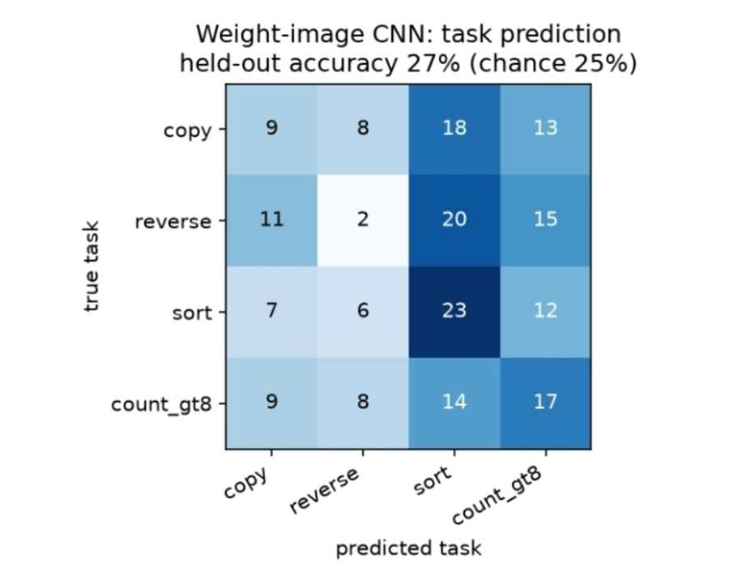
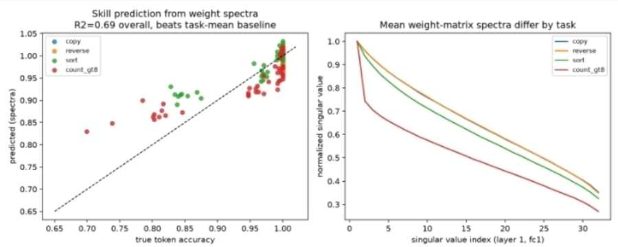
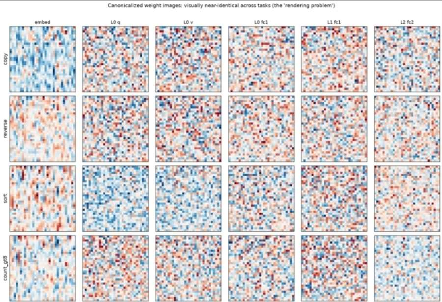
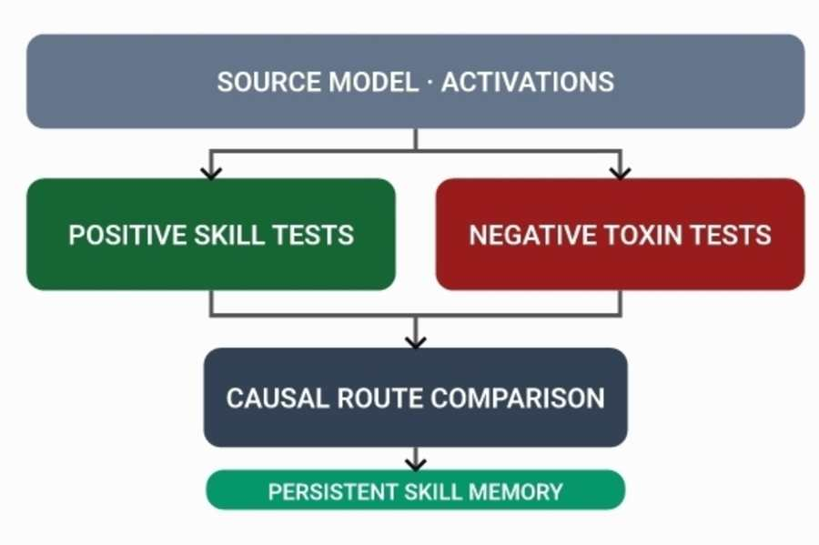

# Weight-image evidence → controlled research experiment

## Previous, user-supplied figures (not rerun)

The five figures provided on 2026-11-01 were descriptive results, not raw training logs or independently reproducible checkpoints. The matrix in the screenshot is:

| True \ Predicted | copy | reverse | sort | count_gt8 |
|:--|--:|--:|--:|--:|
| copy | 9 | 8 | 18 | 13 |
| reverse | 11 | 2 | 20 | 15 |
| sort | 7 | 6 | 23 | 12 |
| count_gt8 | 9 | 8 | 14 | 17 |

- Derived from the supplied confusion matrix: 51/192 correct = **26.5625%**; four-way balanced chance is 25%. CNN task classification therefore remains near chance on that evaluation.
- The supplied spectral regression plot reports **R² = 0.69**, and the screenshot describes different task spectra. Its run configuration, confidence interval, model identity, and split provenance were not available for independent verification.
- The supplied weight tiles appear visually similar after per-matrix canonicalization, suggesting that this rendering removes or obscures task-discriminative information.
- The supplied positive-skill versus negative-toxin route diagram is a **research proposal**, not an observed causal trace.

The [confusion matrix SVG](../evidence/confusion-matrix.svg) is a **redrawing** of the supplied matrix, not the original screenshot. The source filenames, dimensions and hashes are preserved in `evidence/source-manifest.json` for provenance; The Git repository includes downscaled JPEG previews, not the original screenshots. Previews are for human interpretation and must not be used as quantitative training data.

### User-supplied figure previews

These are downscaled reproductions of the provided images, not newly generated experimental measurements.









[Read the accompanying original report excerpt preview](../evidence/previews/experiment-report-preview.jpg).

## New controlled experiment

The optional experiment trains one `SkillMLP` per `(task, initialization_seed)`. For each seed all four tasks start from the **same initial weights**. Each model sees synthetic 8-token arrays and learns one of copy, reverse, sort or count of values strictly greater than 8. The count task is scored only at its first output position, not on padding.

The experiment extracts separate feature families:

- `raw.*`: unnormalized signed parameter statistics.
- `spectral.*`: normalized singular-value spectra, effective rank, and separately retained absolute norms.
- `activation.*`: activation statistics on identical task-agnostic inputs, **not** behavioral labels.
- `init_*`: corresponding untrained weight features as a negative control.

Each classifier holds out **an entire initialization seed**; no model with that seed appears in its training fold. `majority_baseline_accuracy` and balanced chance are included. Leave-one-seed-out performance regression uses spectral features only. Since each task learns at different rates, the training/performance confound remains and must be studied explicitly.

### Run on Kaggle GPU

The code does not download any model and requires no hidden datasets. Kaggle generally includes PyTorch and scikit-learn, but install the optional requirements if missing:

```sh
pip install -r requirements-research.txt
PYTHONPATH=src python -m rootforge_skill_surgery.research.experiment \
  --device auto --seeds 8 --steps 160 --batch-size 96 \
  --patch-task copy --output runs/experiment_001
```

The `--device auto` flag selects CUDA when available and otherwise CPU. Set `--device cuda` to require a GPU. The output path must be new/empty to avoid silently overwriting measurements.

Outputs:

- `models_features.csv`: full trained and initial features, task, seed, behavior accuracy, and checkpoint SHA-256.
- `predictions.csv`: held-out model task labels and predictions per feature family.
- `causal_routes.csv`: causal intervention sites, positive and negative directions, matched-size random controls, and bootstrap CIs.
- `summary.json`: feature comparison, held-out spectral performance regression, per-seed scores, experimental configuration, environment, and interpretation limits.

### Causal patching design

For the designated task, only the model from the final held-out seed is examined. Independent calibration and evaluation counterfactual pairs differ in one input token; the correct output must change and both clean/corrupted output tokens must be predicted correctly. The feature shortlist is ranked by mean activation difference on calibration examples. During evaluation, the code compares:

1. Clean versus corrupted target/foil logit margins.
2. Full-site recovery: an **architectural sanity check**, not localization evidence.
3. Top-k neuron restoration (sufficiency-style test).
4. Same-size random-neuron restoration (negative control).
5. Reverse top-k corruption of clean activations (necessity-style test).

A 95% paired bootstrap interval is reported for top-k versus random restoration; only a positive lower bound supports comparative localization in this toy setting. This is **node** patching; it does **not** establish minimal causal edges or weight-level unlearning.

### Nonclaims and next experiments

- The experiment trains tiny task-specific toy networks, **not** the user's original SmolLM2, Qwen, or ARC models.
- It does not turn image pixels into hidden reasoning or infer causal circuits from an image.
- A high regression R² does not prove that an internal skill has been uniquely localized.
- Skill removal, latent-recovery testing, contamination-resistant weight edits, and portable LoRA extraction are **not implemented**.
- Generalization should be retested with more seeds, matched performance checkpoints, alternative architectures, and independent source-model checkpoints before acting on any claimed skill route.
